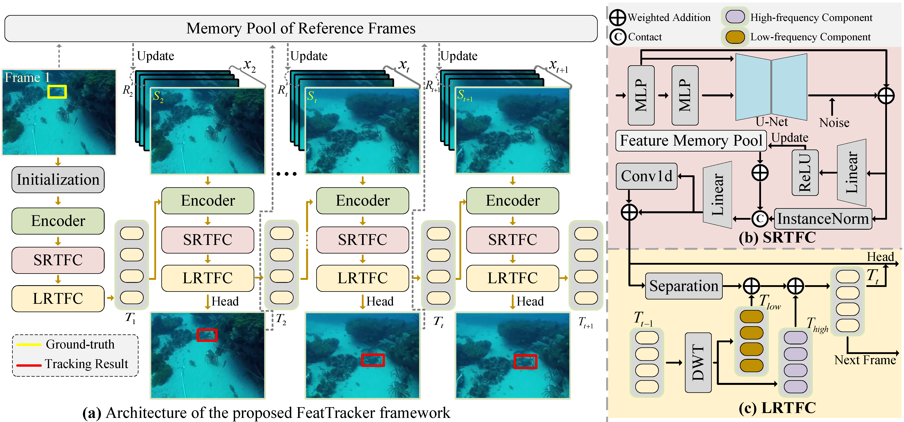

# [ECCV 2026] FeatTracker

**[FeatTracker: Short- and Long-Range Temporal Feature Consistency for Robust Underwater Object Tracking](https://media.eventhosts.cc/Conferences/ECCV2026/pdfs/3771.pdf)**

Jiaqing Li, Bin Lin, Chaocan Xue, Wu Ai, Qingping Zheng

Official implementation of **FeatTracker** (ECCV 2026).

[[Paper](https://media.eventhosts.cc/Conferences/ECCV2026/pdfs/3771.pdf)] [[Models - Google Drive](https://drive.google.com/drive/folders/1YuUgIDeuEJrXkVHpnjK20rkfneV_mOPB?usp=sharing)] [[Models - Baidu Drive](https://pan.baidu.com/s/1xq2_uIGa7om5IHztncTLIA?pwd=g2bs)] [[Raw Results - Google Drive](https://drive.google.com/drive/folders/1uN5ck_AXBSyFCspVbgj3I2HlLMF4VFyo?usp=sharing)] [[Raw Results - Baidu Drive](https://pan.baidu.com/s/10oHG3ByH1WKXFnN8qzScPA?pwd=hwa4)]

---

## Highlights

FeatTracker is a feature-level framework for underwater object tracking (UOT)
that enforces temporal feature consistency through two complementary modules:

* **Short-Range Temporal Feature Consistency (SRTFC)** — diffusion-like
  feature enhancement (DFE) followed by a dynamic memory pool, mitigating
  underwater degradation while preserving local temporal coherence.
* **Long-Range Temporal Feature Consistency (LRTFC)** — Haar wavelet
  decomposition of the historical temporal token, retaining stable structure
  and fine trajectory details over long sequences.

<p align="center">
  
</p>

<p align="center">
  <em>Overview of the FeatTracker framework.</em>
</p>

The model is built on ODTrack (ViT-Base with a center head). Both modules are
controlled from the YAML configuration, so they can be enabled or disabled
without changing the code.

| Paper module | Implementation |
|:---|:---|
| SRTFC: DFE + short-range feature memory pool | [`lib/models/layers/srtfc.py`](lib/models/layers/srtfc.py) |
| LRTFC: long-range temporal token propagation | [`lib/models/layers/lrtfc.py`](lib/models/layers/lrtfc.py) |
| Overall framework | [`lib/models/feattracker/feattracker.py`](lib/models/feattracker/feattracker.py) |

## Results

Comparison with representative visual trackers and underwater-specific
trackers on four UOT benchmarks. The baseline rows are taken from Table 1 of
the paper and correspond to the **original released versions** of each method
(variants retrained on the same UOT data are omitted). The FeatTracker row
reports the results in the paper.

| Method | WebUOT-1M<br>AUC / P | UW-COT220<br>AUC / P | VMAT<br>AUC / P | UTB180<br>AUC / P |
|:---|:---:|:---:|:---:|:---:|
| **[FeatTracker](https://github.com/fishgfish/FeatTracker)** | **67.62 / 68.84** | **61.50 / 58.35** | **61.25 / 78.07** | **81.40 / 86.52** |
| [ODTrack](https://github.com/GXNU-ZhongLab/ODTrack) | 63.82 / 60.88 | 60.38 / 56.38 | 54.66 / 67.73 | 69.96 / 64.48 |
| [UOSTrack](https://github.com/LiYunfengLYF/UOSTrack) | 60.57 / 55.96 | 56.87 / 50.94 | 55.84 / 67.90 | 66.65 / 60.05 |
| [OKTrack](https://github.com/983632847/Awesome-Multimodal-Object-Tracking/blob/main/WebUOT-1M/README.md) | 62.05 / 59.13 | 59.17 / 53.82 | 53.82 / 66.83 | 69.24 / 66.46 |
| [PUTrack](https://github.com/faicaiwawa/PUTrack) | 54.06 / 49.56 | 47.05 / 38.54 | 43.14 / 54.12 | 73.12 / 70.47 |

## Installation

The code is tested with Python 3.8 and PyTorch 1.10.0 (CUDA 11.3). Two
equivalent workflows are supported. A helper script drives both of them:

```bash
bash setup_env.sh conda   # create the conda environment
bash setup_env.sh uv      # create .venv with uv and install dependencies
bash setup_env.sh pip     # install into the currently active environment
```

The steps are listed below.

### Option 1: Conda

```bash
conda create -n feattracker python=3.8 -y
conda activate feattracker
bash install.sh
```

Alternatively, create the environment from the provided file:

```bash
conda env create -f environment.yml
conda activate feattracker
```

If your CUDA driver is not compatible with CUDA 11.3, build a matching
environment and install PyTorch for your CUDA version, e.g.
`CUDA_TAG=cu118 bash install.sh`.

### Option 2: uv

```bash
# Install uv if it is not available yet.
curl -LsSf https://astral.sh/uv/install.sh | sh

uv venv --python 3.8
source .venv/bin/activate

# Resolve and install all dependencies (PyTorch comes from the cu113 index
# configured in pyproject.toml).
uv sync
```

If `uv sync` is not desired, install the packages explicitly:

```bash
uv pip install torch==1.10.0+cu113 torchvision==0.11.0+cu113 \
    --extra-index-url https://download.pytorch.org/whl/cu113
uv pip install -r requirements.txt
```

## Data Preparation

Download the benchmarks (LaSOT, GOT-10k, WebUOT-1M, HUT290, UVOT400, UTB180, UW-COT220, VMAT) and place them under `./data`. The
default paths in `lib/train/admin/local.py` and
`lib/test/evaluation/local.py` follow this layout:

```
${PROJECT_ROOT}
 -- data
     -- lasot
     -- got10k
         |-- train
         |-- val
     -- webuot
         |-- Train
         |-- Test
     -- hut290
     -- uvot400
         |-- train
         |-- test
     -- utb180
     -- uwcot220
     -- vmat
         |-- jpgs
         |-- annotations
```

Datasets use the UOT convention: each sequence directory contains an `imgs`
folder (or `img`) and a `groundtruth_rect.txt` annotation, while the
dataset root provides `list.txt` where required.

## Set Project Paths

The shipped `local.py` files resolve every dataset relative to the project
root, so no change is needed if the data lives under `./data`. To regenerate
the path files for a custom layout, run:

```bash
python tracking/create_default_local_file.py \
    --workspace_dir . --data_dir ./data --save_dir ./output
```

You can also edit the paths directly:

```
lib/train/admin/local.py        # training paths
lib/test/evaluation/local.py    # testing paths
```

## Pre-trained Weights

Download the MAE ViT-Base initialization and place it under
`pretrained_networks/`:

```bash
mkdir -p pretrained_networks
wget -P pretrained_networks https://dl.fbaipublicfiles.com/mae/pretrain/mae_pretrain_vit_base.pth
```

## Model Zoo

| Model | Config | Epoch | Download |
|:---:|:---:|:---:|:---:|
| FeatTracker | `experiments/feattracker/feattracker.yaml` | 300 | [Google Drive](https://drive.google.com/drive/folders/1YuUgIDeuEJrXkVHpnjK20rkfneV_mOPB?usp=sharing) / [Baidu Drive](https://pan.baidu.com/s/REPLACE_MODEL_SHARE_ID) |

Released checkpoints and raw results are hosted on Google Drive and Baidu
Drive (links at the top of this page). The raw-results package contains the
paper's FeatTracker result files (`raw_results/feattracker_300`) and the
reproduced baseline results (`raw_results/baselines`). Place the
downloaded checkpoint under
`output/checkpoints/train/feattracker/feattracker/FeatTracker_ep0300.pth.tar`.

Checkpoints created by the pre-release code use the internal module names
(`corrector`, `sscm`, `wave_propagate`). They are mapped automatically when
loaded, so no conversion step is required.

## Training

```bash
python tracking/train.py \
    --script feattracker --config feattracker \
    --save_dir ./output \
    --mode multiple --nproc_per_node 3 \
    --use_lmdb 0
```

Use `--mode single` for a single GPU. Training uses LaSOT, HUT290, UVOT400
and WebUOT-1M with the hybrid training strategy described in the paper, a
batch size of 5, and 300 epochs with the learning rate decayed at epoch 240.

We use [wandb](https://github.com/wandb/client) for logging; pass
`--use_wandb 0` to disable it.

## Testing and Evaluation

Run the tracker on a benchmark:

```bash
python tracking/test.py feattracker feattracker \
    --dataset_name webuot --runid 300 --num_gpus 1
```

`--runid` selects the checkpoint epoch and the result directory and defaults
to 300, e.g. `output/test/tracking_results/feattracker/feattracker_300/`.
Supported UOT datasets include `webuot`, `uwcot220`, `utb180`, `vmat`,
`hut290`, `uot100`, `uot32` and `uvot400`.

Report the cached scores:

```bash
python tracking/analysis_results.py --param feattracker --runid 300
```

For GOT-10k and TrackingNet, convert the raw results after tracking:

```bash
python lib/test/utils/transform_got10k.py --tracker_name feattracker --cfg_name feattracker_300
python lib/test/utils/transform_trackingnet.py --tracker_name feattracker --cfg_name feattracker_300
```

## Profiling

```bash
python tracking/profile_model.py --config feattracker
```

## Citation

If you find this work useful for your research, please cite:

```bibtex
@inproceedings{feattracker,
  title={FeatTracker: Short- and Long-Range Temporal Feature Consistency for Robust Underwater Object Tracking},
  author={Li, Jiaqing and Lin, Bin and Xue, Chaocan and Ai, Wu and Zheng, Qingping},
  booktitle={ECCV},
  year={2026}
}
```

## License

This project is released under the GNU General Public License v3.0. See
[LICENSE](LICENSE) for the full text.

## Acknowledgments

This codebase is built upon [ODTrack](https://github.com/GXNU-ZhongLab/ODTrack),
[STARK](https://github.com/researchmm/Stark) and
[PyTracking](https://github.com/visionml/pytracking). We thank the authors for
releasing their code.
